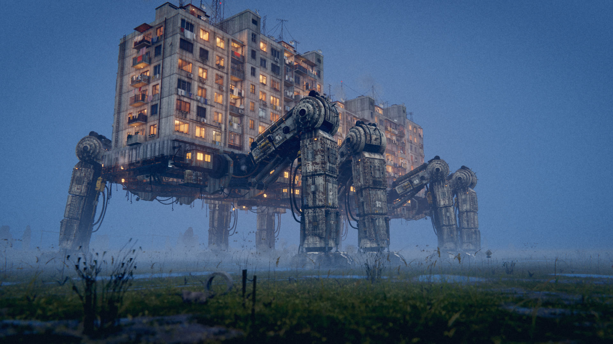
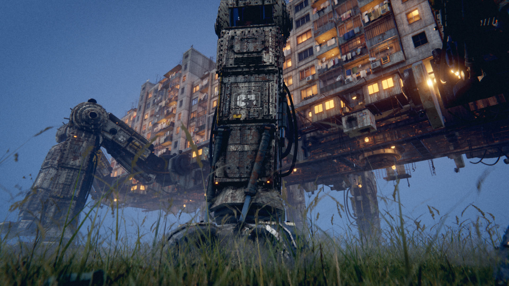
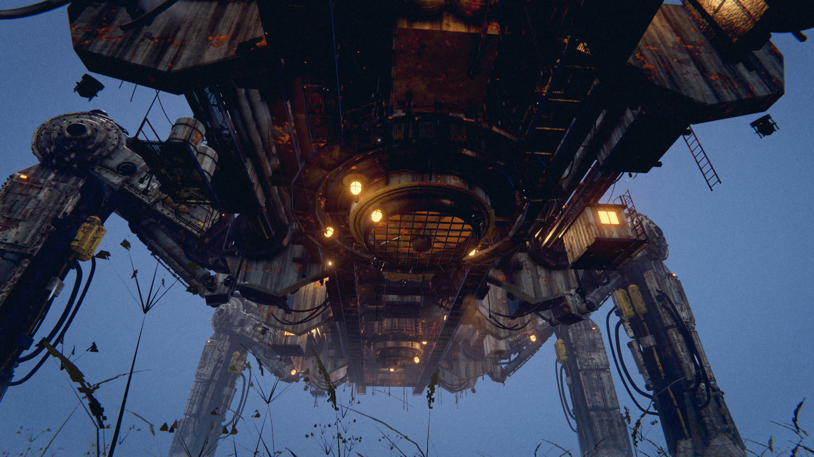
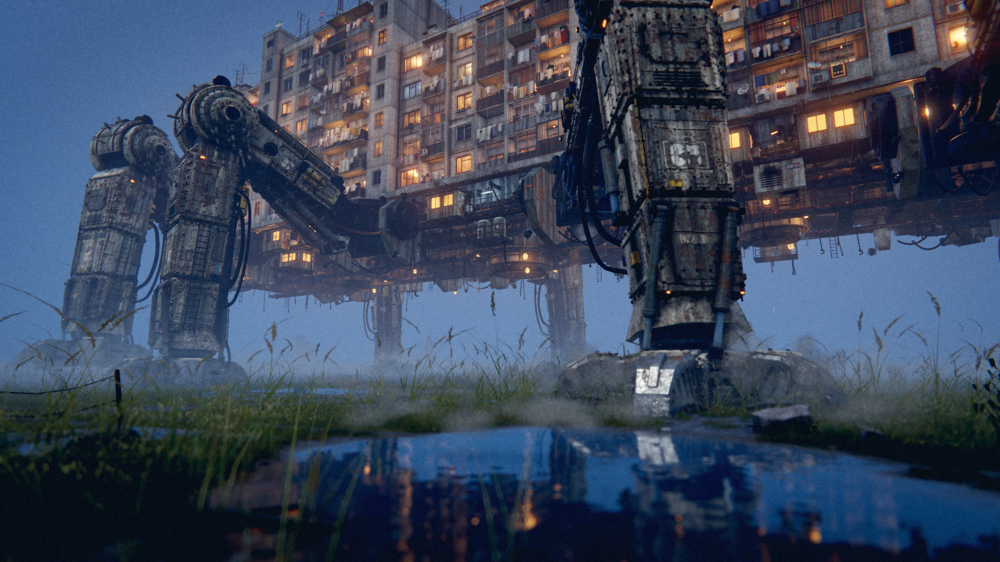
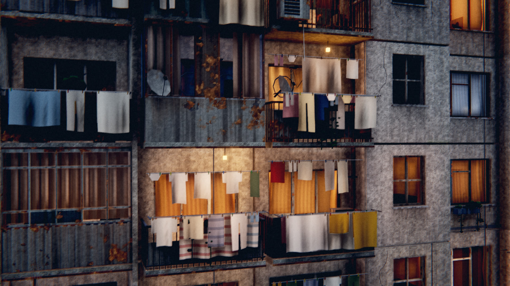
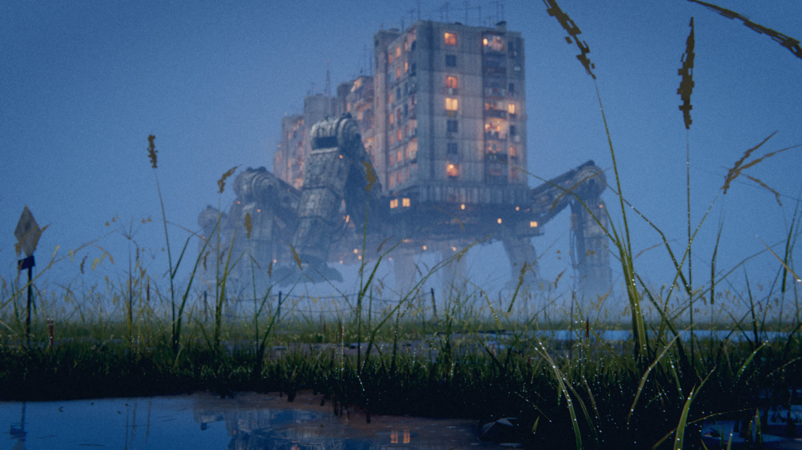
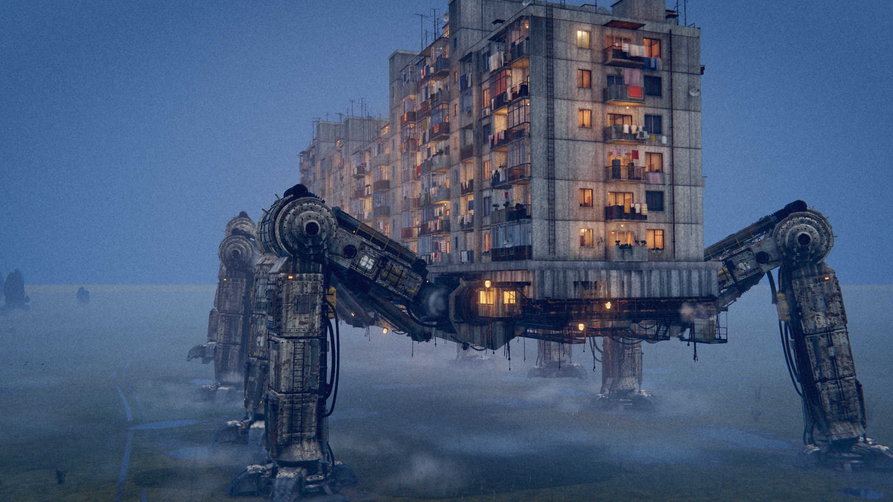

# Walking Block

A colossal Soviet panel apartment block on eight mechanical legs, crossing a wet field in blue dusk fog.
Everything you see is code: procedural geometry, procedural textures and shaders in three.js. No 3D assets,
no image textures. A 45 s film is rendered from the same scene.



| | |
|---|---|
|  |  |
|  |  |
|  |  |

**The film (1080p30, 45 s, with sound):** see the [latest release](../../releases/latest).

## How it was made
Built with Claude Fable 5.2 as the main agent and Fable 5.2 / Opus 5.5 subagents, iterating on stills and
storyboards captured from headless Chrome against a handful of reference images (the references are not part
of this repo). The scene is about 5.4 million triangles per frame and was rendered offline, frame by frame,
on an integrated laptop GPU (Radeon 780M).

The only thing that is not code is the sound: music and sound effects are downloaded, freely licensed
recordings, placed and mixed by a script. See [audio/CREDITS.md](audio/CREDITS.md).

## Run it
```
npm install
npm start            # http://127.0.0.1:5177/
```
- `/` plays the 45 s film timeline in real time (Space = pause, ←/→ = seek).
- `/?shot=ref2` shows a single camera preset (`ref1…ref6`, `facade`, `leg`, `foot`, `belly`, `f_hero`, `f_foot`, …).
- `/?free` gives an orbit camera. Add `&scale=0.5` on slower GPUs — the scene is heavy.

## Render the film yourself
Needs Chrome and ffmpeg (set `CHROME_PATH` if Chrome is not in the default Windows location).
```
npm run audio        # soundtrack -> out/audio.wav
npm run render       # 1350 frames -> out/frames (resumable)
npm run mux          # -> out/walking_block_1080p30.mp4
```
Other tools: `node tools/shot.mjs --shots f_hero --ts 13.4 --mb 4 --prefix x` (stills),
`npm run storyboard` (contact sheet of the timeline).

## Layout
- `src/main.js` – scene bootstrap, lights, module loader, deterministic frame rendering
- `src/post.js` – ambient occlusion, height fog + sky, depth of field, bloom, grade, film grain, motion-blur accumulation
- `src/look.js` – colours, fog, lights and grade · `src/gait.js` – stateless walk cycle · `src/shots.js` – cameras and film timeline
- `src/materials.js`, `src/textures.js` – shared weathering shader (grime, drip streaks, moss, paint chips, rust, wetness)
- `src/mods/building.js` – the apartment block (interior-mapped windows, loggias, laundry, roof)
- `src/mods/legs.js` – the eight legs (IK rig, hydraulics, hoses, claws)
- `src/mods/chassis.js` – the mechanical belly · `src/mods/env.js` – ground, vegetation, puddles, footprints
- `src/mods/fx.js`, `src/mods/atmo.js` – footfall debris and spray, fog banks, smoke, rain, birds
- `src/mods/README.md` – the module contract the agents worked from
- `tools/` – capture, render, soundtrack and encode scripts

Everything is a pure function of time, so any frame can be rendered in any order.

## Licence
Code: MIT (see [LICENSE](LICENSE)).
Audio: third-party, under its own licences — music "The Long Dark" by Scott Buckley, released under
CC-BY 4.0 (www.scottbuckley.com.au); sound effects from freesound.org under CC0. Details in
[audio/CREDITS.md](audio/CREDITS.md).
